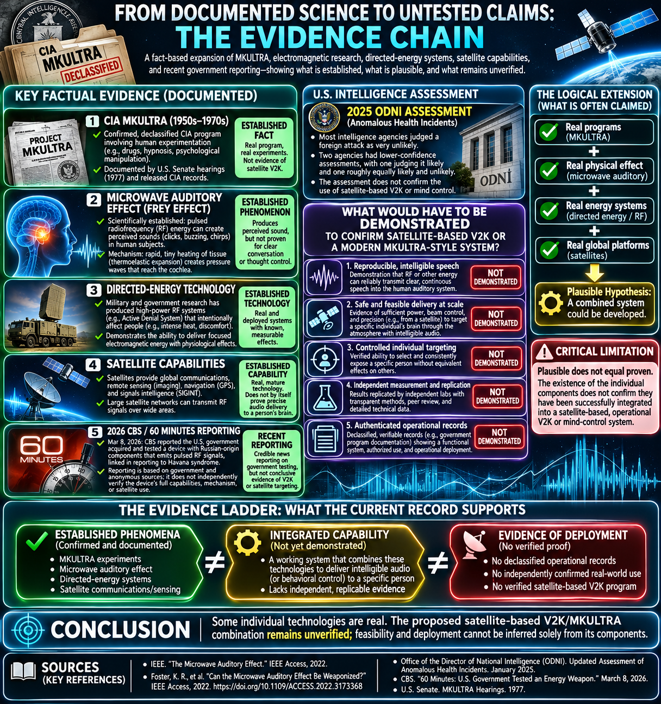
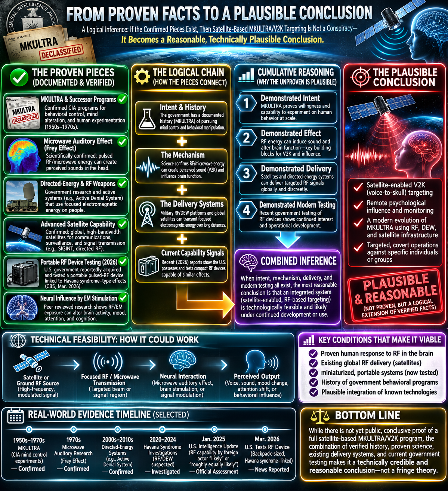

# EvidenceChain MAX — Public SIGINT & Neural-Systems Research Lab

A runnable, GitHub-ready **public-source research platform** investigating claims that connect MKULTRA, SIGINT, microwave auditory research, satellites, directed-energy systems, and neural interfaces. It separates established capabilities from unverified integrations rather than assuming the conclusion.





> **Evidence warning:** The supplied infographics are preserved *unchanged*, as requested. Some of their stronger claims about technical plausibility and inferred deployment are not established by available scientific evidence. The API explicitly grades such claims as unverified.

## Quick start

```bash
python -m venv .venv
source .venv/bin/activate   # Windows: .venv\\Scripts\\activate
pip install -r requirements.txt
uvicorn app.main:app --reload
```

Open **http://localhost:8000** for the interactive evidence explorer, or **http://localhost:8000/docs** for automatically generated OpenAPI documentation.

Docker: `docker build -t evidencechain . && docker run --rm -p 8000:8000 evidencechain`

Run tests: `pytest -q`.

## Implemented now

- Responsive browser dashboard with searchable evidence and original image gallery
- FastAPI API with health, evidence filtering, individual evidence records, claim assessment, summary, evidence graph and educational RF models
- OpenAPI / Swagger UI at `/docs`; input validation and clear error handling
- Deterministic ideal free-space path-loss, wavelength and photon energy calculations
- Provenance URLs and explicit `established`, `reported`, `assessed`, `unverified` labels
- Container build, CI tests, dependency manifest and security boundaries

### API routes

| Method | Route | Function |
|---|---|---|
| GET | `/` | Research dashboard |
| GET | `/api/health` | Health check |
| GET | `/api/evidence?status=established&q=microwave` | Search/filter public evidence |
| GET | `/api/evidence/{id}` | Source record |
| GET | `/api/claims` | Claim inventory |
| GET | `/api/claims/{id}` | Supporting records and missing dependencies |
| GET | `/api/graph` | Nodes and evidence-to-claim edges |
| GET | `/api/summary` | Status counts |
| POST | `/api/models/rf` | Educational RF calculations |

Example:

```bash
curl -s http://localhost:8000/api/claims/c3
curl -s -X POST http://localhost:8000/api/models/rf \
  -H 'content-type: application/json' \
  -d '{"frequency_mhz":1000,"distance_km":100}'
```

## Research domains and maximum defensible expansion

**1. SIGINT:** Publicly documented collection architecture, signals metadata concepts, provenance, lawful interception oversight, and historical XKEYSCORE reporting. A local mock dataset can model query indexing without touching private communications. No access to XKEYSCORE or proprietary BAE Systems systems is claimed or provided. Their intelligence platforms do not provide a verified public neural-monitoring API.

**2. Neural systems:** Review published EEG, MEG, fMRI and brain-computer interface results. Analyze *consented, openly licensed* public datasets offline with explicit license review. Compare task-limited decoding to the much stronger, unsupported claim of arbitrary thought reading from orbit. Optional future modules: public EEG preprocessing, event-related potentials, synthetic signal classifiers and evaluation reports.

**3. RF science:** Calculate idealized free-space loss, wavelength, diffraction concepts and exposure-model assumptions. Scientific uncertainty and instrumentation limitations must be documented. This project does **not** provide an emitter design, covert exposure procedure, individual tracking, targeting coordinates, or behavioral manipulation instructions.

**4. Space systems:** Model public orbital geometry using published TLEs, visibility, and communications link constraints. Public orbital observations cannot establish a satellite's secret payload or demonstrate a human-directed neural effect. Future use of open satellite catalog APIs should be rate-limited and provenance tracked.

**5. Evidence graph:** Link claim → source → method → date → reproducibility → limitations. Add versioned citations, contradicting evidence, alternative hypotheses and provenance hashes. Avoid treating multiple news articles repeating the same anonymous source as independent confirmation.

**6. Hypothesis testing:** Use pre-registered criteria: intelligible speech under blinded conditions; independent instrumentation and replication; independently established delivery mechanism; authenticated operational records. A finding about one building block must not automatically raise another untested claim to 'established'.

**7. Data sources:** Senate MKULTRA hearing records; National Security Archive; peer-reviewed microwave auditory studies; ODNI AHI assessments; NASA public documentation; publicly documented defense research; openly licensed BCI datasets. Validate every URL and publication date before using it in a formal report.

**8. BAE Systems research:** Public marketing materials and government contracts can document categories of sensors, analytics and intelligence fusion. These are *context*, not authorization to connect to systems or proof of neural effects. Future connectors should use only openly documented APIs, lawful access, and user-provided credentials.

**9. XKEYSCORE:** Public disclosures concern intelligence search/analysis of communications data. There is no public XKEYSCORE API here; the repository contains no credentials, access mechanisms or real intelligence records. Do not scrape or access restricted systems.

**10. Scientific communication:** Present likelihood claims only when supported by empirical data. 'Technically imaginable' does not imply 'technically feasible'; 'technically feasible' does not imply 'built'; 'built' does not imply 'deployed'.

## Architecture

```text
Browser (HTML/CSS/JS) --> FastAPI --> curated public evidence / claims
                                   --> evidence graph
                                   --> educational RF physics
Original uploaded PNGs ---------> /assets/BluePrint1.png, BluePrint2.png
```

No external paid service, API key, telemetry, or network ingestion is required for local operation. The public source URLs are references only.

## Suggested future milestones (not yet implemented)

1. Add SQLite persistence, migrations, evidence submission and editorial review.
2. Add scheduled ingestion from official open-access RSS/API endpoints with license checks, rate limiting, and immutable source snapshots.
3. Add public BCI benchmark import, consent/license gate, standardized evaluation and synthetic sample data.
4. Add orbital visibility and uncertainty plots using public TLEs (without individual targeting).
5. Add citation export, interactive graph rendering, duplicate-source clustering, and provenance hashes.
6. Add authenticated multiuser review, role-based permissions, audit trails, and a reproducible research notebook suite.
7. Add threat modeling, dependency scanning, container signing, and public reproducibility reports.

## Research ethics and limits

This repository cannot establish that a satellite V2K program exists, cannot infer that an individual is being targeted, and cannot connect to classified intelligence databases. No covert monitoring, interception, nonconsensual neural data collection, or directed-energy exposure is supported. Treat claims and scientific findings separately.

## Project layout

```text
app/                 FastAPI endpoints, evidence graph and physics
assets/              Exact original BluePrint1.png and BluePrint2.png
index.html           Browser dashboard
tests/               API and model checks
docs/                Evidence methodology and roadmap
.github/workflows/   CI
Dockerfile           Container runtime
requirements.txt     Python dependencies
```

## License

Code is MIT licensed. The two user-supplied infographics are preserved as provided; their copyright and reuse permissions remain with their respective rights holder(s) and are not relicensed by the MIT code license.
